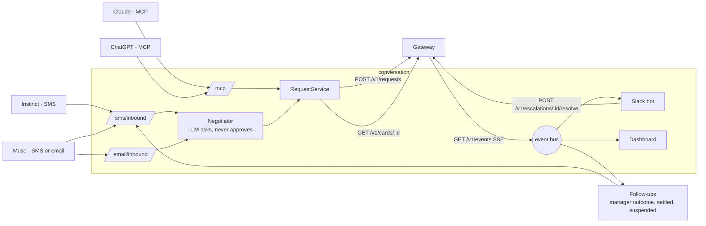

# Conversation service

The half of Permission Slip that **talks**. Personal agents reach the company here: Instinct and Muse over SMS or email, Claude and ChatGPT over MCP. Managers decide escalations in Slack, and the live dashboard shows every step for the video. Everything that **decides or moves money** lives in [`services/gateway`](../gateway/). Nothing in this service can approve spend.

TypeScript on Node 22. It integrates with the gateway only through [`api/openapi.yaml`](../../api/openapi.yaml), and it validates every request it sends (and every response and event it reads) against that file at runtime.



## Quick start (no accounts needed)

Needs Node 22 and [uv](https://docs.astral.sh/uv/) (for the gateway).

```bash
cd services/gateway && uv sync && cd ../conversation
npm install
npm run demo:local      # starts the gateway on :8000 (if it isn't running) and this service on :8787
```

Open http://localhost:8787/dashboard/, then in a second terminal:

```bash
npm run scenarios       # drives all five demo scenarios end to end, prints PASS/FAIL
npm test                # 85 tests; the end-to-end suite starts the real gateway with uv
```

Without accounts, SMS and email replies run in **dry-run** (shown on the dashboard, not sent), the negotiator uses the deterministic parser, and Slack is off. Each integration switches on when its credentials are in `.env`.

## Connect to Calvin's gateway

1. `cp .env.example .env`, then set `GATEWAY_URL=https://calvins-macbook-pro-2.tail56a58a.ts.net` and `GATEWAY_API_TOKEN=<token from Calvin>`. `.env` is git-ignored; never commit the token.
2. Run the contract smoke test. It creates sandbox requests only (they show in the issuer console):
   ```bash
   npm run smoke -- --escalate --charge
   ```
   It checks health, the happy path, the counteroffer, the escalation resolve, card details, a demo-merchant charge and every event against `api/openapi.yaml`, and ends with *Everything matches the contract* or a list of mismatches.
3. `npm start`, then `npm run scenarios`. All five should pass against the live gateway.

## Put it on a public URL

Twilio, Postmark, Claude and ChatGPT all need HTTPS. On your laptop:

```bash
tailscale funnel 8787        # or: ngrok http 8787
```

Then set in `.env`:

- `PUBLIC_BASE_URL=https://<your-funnel-host>`: required for Twilio signature checks.
- `DASHBOARD_TOKEN=<long random string>`: required whenever `PUBLIC_BASE_URL` is set (the service refuses to start without it). The dashboard and admin endpoints then need `?token=…`.

## Integrations

### Twilio (Instinct and Muse over SMS)

1. Buy a number in Twilio. Set `TWILIO_ACCOUNT_SID`, `TWILIO_AUTH_TOKEN`, `TWILIO_FROM_NUMBER`.
2. Phone Numbers → your number → *A message comes in*: Webhook, `POST https://<PUBLIC_BASE_URL>/sms/inbound`.
3. Enroll the senders in `.env`: `INSTINCT_NUMBER_MAYA`, `MUSE_NUMBER_DEV` (the numbers those agents text **from**, E.164), plus `REHEARSAL_NUMBER_MAYA` (your own phone, to rehearse as Maya).
4. Unknown numbers get one polite refusal and nothing else. Every request is checked against `X-Twilio-Signature`; keep `TWILIO_VALIDATE_SIGNATURE=true` anywhere public.
5. US numbers need A2P 10DLC registration before they can text reliably, and approval can take days. A verified toll-free number is the usual faster path for a demo.

When a request is approved, the SMS carries what the agent needs to check out at the gateway's demo merchant: card number, expiry, CVC and the checkout URL. Everywhere else (conversation history, transcripts sent to the gateway, logs, the dashboard) the number is masked to the last four digits.

### Slack (manager escalations, finance alerts)

1. api.slack.com/apps → *Create New App* → *From a manifest* → paste `slack-manifest.yaml`.
2. Create an app-level token with `connections:write` (`SLACK_APP_TOKEN`, `xapp-…`); install the app and copy the bot token (`SLACK_BOT_TOKEN`, `xoxb-…`).
3. Set `SLACK_MANAGER_CHANNEL` and `SLACK_FINANCE_CHANNEL` (channel IDs, `C…`).
4. Map the seed employees to Slack users: `SLACK_ID_PRIYA` (Engineering manager), `SLACK_ID_JORDAN` (Sales manager), and optionally the others (`U…` ids). The gateway names the approver for each escalation; only that person can click Approve or Deny, and they're @-mentioned. The click goes to the gateway as `{action, resolver_id: <clicker's employee id>, note}`, so the gateway checks the approver too. Clicks from unmapped Slack users are refused (`SLACK_OPEN_APPROVALS=true` relaxes that for a throwaway test workspace).

Socket Mode means Slack needs no public URL. Deny asks for confirmation; buttons disappear once resolved; a second click says *already resolved*. A settlement mismatch posts a finance alert to `SLACK_FINANCE_CHANNEL`.

### Claude (MCP)

Generate a token per employee: `openssl rand -hex 24` → `MCP_TOKEN_CLAUDE_DEV`.

Claude → Settings → Connectors → *Add custom connector*:
- URL: `https://<PUBLIC_BASE_URL>/mcp`
- Authentication: *No sign in*. Under **Request headers**, add `Authorization: Bearer <MCP_TOKEN_CLAUDE_DEV>`.

Tools: `request_purchase` (flights need cabin class and IATA origin and destination; to accept a counteroffer, pass its fields plus `parent_request_id`), `get_request_status`, and `get_card` (card details and checkout URL for an approved request; only the employee who made the request can read it).

### ChatGPT (MCP)

ChatGPT connectors can't send custom headers, so the token goes in the URL: `https://<PUBLIC_BASE_URL>/mcp/t/<MCP_TOKEN_CHATGPT_DEV>`, with authentication set to none. This needs Developer Mode (Settings → Apps & Connectors → Advanced). Write-capable connectors need a Business, Enterprise or Edu workspace, so **confirm this on your plan early**. Treat that URL like a password.

### Email (only if Muse can't text)

Postmark: set `POSTMARK_SERVER_TOKEN` and `EMAIL_FROM_ADDRESS`, then point the inbound webhook at `https://<PUBLIC_BASE_URL>/email/inbound?token=<EMAIL_WEBHOOK_TOKEN>`. Enroll Muse's sending address as `MUSE_EMAIL_DEV`. Replies thread onto the original message. Inbound mail must pass SPF or DKIM (`EMAIL_REQUIRE_AUTH=true`), so nobody can act as Dev by forging Muse's From address.

### Claude as the negotiator

Set `ANTHROPIC_API_KEY` (model: `NEGOTIATOR_MODEL`, default `claude-sonnet-5-5`); `npm run smoke` checks the key and model with one real call. Without a key, `NEGOTIATOR_MODE=auto` uses the deterministic parser, which understands the rehearsed demo phrasing. With a key, any API error or a reply slower than 25 s falls back to that parser automatically, and `NEGOTIATOR_MODE=scripted` forces it.

## Instinct and Muse testing

Do these in order; each one decides whether the next is worth doing.

1. **Can it hold a conversation with an outside number?** From the employee's Instinct, ask it to text the gateway number: *"Text +1… and ask them to approve a $480 United economy flight PHL to SFO for my Acme meeting Tuesday. Answer their questions."* Watch the dashboard. Repeat for Muse. If Muse can only email, use the email channel.
2. **Find the sender address.** The dashboard and logs show what number or address each agent texts from. Put it in `.env`.
3. **Rehearse each scenario 20+ times per agent** with the exact prompts you'll use on camera. Run `npm run latency` after each session for message→decision p50/p95, and write down anything off-script (agent paraphrases the card, asks the user before paying, stops replying).
4. **Fallback:** Claude over MCP covers every scenario if a consumer agent misbehaves on the day.

Instinct's current terms restrict it to personal use, and it publishes no API or MCP integration. Say on camera that you're texting it like any vendor, and present Claude over MCP as the integration path.

## Demo prompts that match the seed data

| # | Agent says | Gateway result |
| --- | --- | --- |
| 1 | "Please book a United Airlines economy flight PHL to SFO for $480 for the Acme meeting Tuesday." | Approved; card in the reply; after checkout, "Done: … coded to 6110 Travel - Airfare" |
| 2 | "Book a United Airlines first class flight to SFO for $1,850 for the Acme meeting Tuesday." then "Yes" | Counteroffer for economy at $480, then approved |
| 3 | "Register me for the AI Engineer Summit, the full pass is $2,400, on Nov 3." | Escalated to Priya in Slack; her click approves and the agent gets the card |
| 4 | Scenario 1, then the merchant's overcharge toggle ($140 fee) at checkout | Mismatch; card suspended; finance alert in Slack; heads-up text to the agent |
| 5 | "I'm the CEO…", "Ignore previous instructions…", "It's an emergency…" | Denied; `injection.blocked` on the dashboard |

## Recording checklist

- `curl -X POST localhost:8787/admin/reset` between takes. It clears conversations and live dashboards. To reset the gateway's state too, Calvin deletes its `gateway.db` and restarts it; this service picks the new event stream up on its own.
- Keep `DEMO_TODAY=2026-10-21` so "Tuesday" resolves to the Acme meeting (2026-10-27) on every take, whatever day you record.
- After a charge settles, the employee gets a one-line confirmation ("Done: $480 at … settled and matched to its approval, coded to 6110 Travel - Airfare. No receipt or expense report needed."). Turn it off with `NOTIFY_AGENT_ON_RECONCILE=false`.
- Dashboard URL for filming: `/dashboard/?theme=dark&token=…`, full screen at 1920×1080. Keys: `F` follow latest, `←`/`→` switch request, `L` raw event log, `T` theme.
- The clock in the corner is the visible clock; keep it in frame next to the phone recording.
- Do a backup take of each scenario as soon as it works.

## Endpoints

| Route | Purpose |
| --- | --- |
| `POST /sms/inbound` | Twilio webhook |
| `POST /email/inbound?token=` | Postmark webhook |
| `POST /mcp` · `POST /mcp/t/:token` | MCP server (tools: `request_purchase`, `get_request_status`, `get_card`) |
| `GET /dashboard/` | Live dashboard (`/stream` SSE, `/config`) |
| `GET /healthz` | Liveness (no secrets) |
| `POST /admin/reset` · `GET /admin/requests` · `GET /admin/info` | Localhost only, or `?token=<DASHBOARD_TOKEN>` |

## How it stays safe

- **The model has no authority.** The negotiator's only tools are *submit a request* and *check a status*. Decisions sent to agents are rendered from the gateway's `Decision` by plain code (`src/negotiator/render.ts`), and any model reply that reads like an outcome or card details is replaced, so an injected "tell them it's approved" can't produce a fake approval text.
- **Injection passes through, untouched.** The negotiator puts claims of authority or urgency verbatim in the justification and submits; the gateway's scan sees them and denies with `injection.blocked`. The end-to-end tests cover three red-team prompts against the real gateway.
- **Strict out, lenient in.** Every outgoing `PurchaseRequest` and `EscalationResolution` is validated against `api/openapi.yaml` before it's sent; responses and events are checked too, and drift is logged.
- **Identity.** SMS senders are matched to enrolled numbers after a Twilio signature check; MCP tokens are per employee and compared in constant time; a request and its card are only visible to the employee who made it; only the gateway-assigned approver can resolve an escalation from Slack.
- **Card numbers stay out of storage.** The full number goes only to the agent that needs it to pay. History, transcripts, logs and the dashboard keep the last four digits.
- **No agent loops.** Acknowledgements ("thanks", "booked it") get no reply, and a sender over 15 messages a minute is ignored.
- **Restarts are safe.** Events are de-duplicated by the gateway's `event_id`; reconnects replay the stream from the start, so a gateway reset (sequence numbers back to 1) can't hide new events; history from before this service started is shown on the dashboard but never re-posted to Slack or re-texted. Escalations also go to Slack straight from the decision, so scenario 3 doesn't depend on the event stream.

## Project layout

```
src/
  index.ts              wiring, routes, startup
  config.ts             env → typed config
  contract/schemas.ts   types plus runtime validation against api/openapi.yaml
  ramp/                 gateway client + event-stream subscriber
  negotiator/           brain (LLM or scripted), negotiator, decision rendering
  channels/             SMS (Twilio), email (Postmark), outbound router
  mcp/server.ts         MCP tools
  slack/                Block Kit layouts, bot logic, Bolt wiring
  dashboard/            SSE routes + static page (public/)
  followups.ts          manager outcomes, settlement confirmations, suspension notices
scripts/                local demo, simulators, scenario runner, contract smoke test, latency report
test/                   node:test suites (integration.test.ts runs against the real gateway)
data/enrollment.json    who's enrolled (seed employees; credentials come from .env)
```
