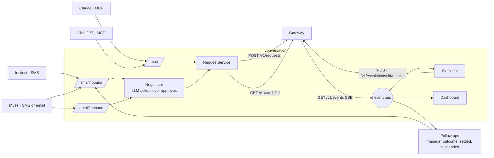

# Conversation service

The half of Permission Slip that **talks**. Personal agents reach the company here: Instinct and Muse over SMS or email, Claude and ChatGPT over MCP. Managers decide escalations in Slack, and a live dashboard shows every step. Everything that **decides or moves money** lives in [`services/gateway`](../gateway/). Nothing in this service can approve spend.

TypeScript on Node 22. It integrates with the gateway only through [`api/openapi.yaml`](../../api/openapi.yaml): every request it sends is validated against that file before it leaves, and every response and event it reads is checked, with any drift logged.



## Quick start (no accounts needed)

Needs Node 22 and [uv](https://docs.astral.sh/uv/) (for the gateway).

```bash
cd services/gateway && uv sync && cd ../conversation
npm install
npm run demo:local      # starts the gateway on :8000 (if it isn't running) and this service on :8787
```

Open http://localhost:8787/dashboard/, then in a second terminal:

```bash
npm run scenarios       # drives all five demo scenarios end to end, prints PASS/FAIL
npm test                # unit, hardening and end-to-end suites; the end-to-end suite starts the real gateway with uv
```

Without accounts, SMS and email replies run in **dry-run** (shown on the dashboard, not sent), the negotiator uses the deterministic parser, and Slack is off. Each integration switches on when its credentials are in `.env`.

## Connect to a remote gateway

1. `cp .env.example .env`, then set `GATEWAY_URL=https://<gateway-host>` and `GATEWAY_API_TOKEN=<token>`. `.env` is git-ignored; never commit the token.
2. Run the contract smoke test. It creates sandbox requests only (they show in the issuer console):
   ```bash
   npm run smoke -- --escalate --charge
   ```
   It checks health, the happy path, the counteroffer, the escalation resolve, card details, a demo-merchant charge and every event against `api/openapi.yaml`, and ends with *Everything matches the contract* or a list of mismatches.
3. `npm start`, then `npm run scenarios`. All five should pass against the live gateway.

## Put it on a public URL

Twilio, Postmark, Claude and ChatGPT all need HTTPS. On your laptop:

```bash
tailscale funnel 8787        # or: ngrok http 8787
```

Then set in `.env`:

- `PUBLIC_BASE_URL=https://<your-funnel-host>`: required for Twilio signature checks.
- `DASHBOARD_TOKEN=<long random string>`: required whenever `PUBLIC_BASE_URL` is set (the service refuses to start without it). The dashboard asks for it once and keeps an HttpOnly session cookie, so the token never appears in a URL; scripts and admin calls send it as the `X-Dashboard-Token` header.

## Integrations

### Twilio (Instinct and Muse over SMS)

1. Buy a number in Twilio. Set `TWILIO_ACCOUNT_SID`, `TWILIO_AUTH_TOKEN`, `TWILIO_FROM_NUMBER`.
2. Phone Numbers → your number → *A message comes in*: Webhook, `POST https://<PUBLIC_BASE_URL>/sms/inbound`.
3. Enroll the senders in `.env`: `MUSE_NUMBER_MAYA`, `INSTINCT_NUMBER_NOAH` (the numbers those agents text **from**, E.164), plus `REHEARSAL_NUMBER_MAYA` (your own phone, to rehearse as Maya).
4. Unknown numbers get one polite refusal and nothing else. Every request is checked against `X-Twilio-Signature`; keep `TWILIO_VALIDATE_SIGNATURE=true` anywhere public.
5. US numbers need A2P 10DLC registration before they can text reliably, and approval can take days. A verified toll-free number is the usual faster path for a demo.

When a request is approved, the SMS carries what the agent needs to check out at the gateway's demo merchant: card number, expiry, CVC and the checkout URL. Everywhere else (conversation history, transcripts sent to the gateway, logs, the dashboard) the number is masked to the last four digits.

### Slack (manager escalations, finance alerts)

1. api.slack.com/apps → *Create New App* → *From a manifest* → paste `slack-manifest.yaml`.
2. Create an app-level token with `connections:write` (`SLACK_APP_TOKEN`, `xapp-…`); install the app and copy the bot token (`SLACK_BOT_TOKEN`, `xoxb-…`).
3. Set `SLACK_MANAGER_CHANNEL` and `SLACK_FINANCE_CHANNEL` (channel IDs, `C…`).
4. Map the seed employees to Slack users: `SLACK_ID_PRIYA` (Engineering manager), `SLACK_ID_JORDAN` (Sales manager), and optionally the others (`U…` ids). The gateway names the approver for each escalation; only that person can click Approve or Deny, and they're @-mentioned. The click goes to the gateway as `{action, resolver_id: <clicker's employee id>, note}`, so the gateway checks the approver too. Clicks from unmapped Slack users are refused (`SLACK_OPEN_APPROVALS=true` relaxes that for a throwaway test workspace).

Socket Mode means Slack needs no public URL. Deny asks for confirmation; buttons disappear once resolved; a second click says *already resolved*. A settlement mismatch posts a finance alert to `SLACK_FINANCE_CHANNEL`.

### Claude (MCP)

Generate a token per employee: `openssl rand -hex 24` → `MCP_TOKEN_CLAUDE_NOAH`.

Claude → Settings → Connectors → *Add custom connector*:
- URL: `https://<PUBLIC_BASE_URL>/mcp`
- Authentication: *No sign in*. Under **Request headers**, add `Authorization: Bearer <MCP_TOKEN_CLAUDE_NOAH>`.

Tools: `request_purchase` (flights need cabin class and IATA origin and destination; to accept a counteroffer, pass its fields plus `parent_request_id`), `get_request_status`, and `get_card` (card details and checkout URL for an approved request; only the employee who made the request can read it).

### ChatGPT (MCP)

ChatGPT connectors can't send custom headers, so the token goes in the URL: `https://<PUBLIC_BASE_URL>/mcp/t/<MCP_TOKEN_CHATGPT_MAYA>`, with authentication set to none. This needs Developer Mode (Settings → Apps & Connectors → Advanced). Write-capable connectors need a Business, Enterprise or Edu workspace, so **confirm this on your plan early**. Treat that URL like a password.

### Email (for agents that can't text)

Postmark: set `POSTMARK_SERVER_TOKEN` and `EMAIL_FROM_ADDRESS`, then point the inbound webhook at `https://<PUBLIC_BASE_URL>/email/inbound?token=<EMAIL_WEBHOOK_TOKEN>`. Enroll Muse's sending address as `MUSE_EMAIL_MAYA`. Replies thread onto the original message. Inbound mail must pass Postmark's own SPF check, aligned with the From domain (`EMAIL_REQUIRE_AUTH=true`), so nobody can act as Maya by forging Muse's From address. Authentication headers inside the message are ignored, since the sender can write those.

### Claude as the negotiator

Set `ANTHROPIC_API_KEY` (model: `NEGOTIATOR_MODEL`, default `claude-sonnet-5-5`); `npm run smoke` checks the key and model with one real call. Without a key, `NEGOTIATOR_MODE=auto` uses the deterministic parser, which understands the demo phrasing. With a key, an API error, a reply slower than 25 s, or a model that can't produce a valid request falls back to that parser automatically (the abandoned call is cancelled), and `NEGOTIATOR_MODE=scripted` forces it.

## Demo prompts that match the seed data

| # | Agent says | Gateway result |
| --- | --- | --- |
| 1 | "Please book a United Airlines economy flight PHL to SFO for $480 for the Acme meeting Tuesday." | Approved; card in the reply; after checkout, "Done: … coded to 6110 Travel - Airfare" |
| 1b | Round trip: "Book me PHL to SFO on Nov 17, back Nov 19" (the agent picks the flights) | Approved under a hidden round-trip cap; the reply restates the itinerary; after the charge, "Booked and paid: …" |
| 2 | "Book a United Airlines first class flight to SFO for $1,850 for the Acme meeting Tuesday." then "Yes" | Counteroffer for economy at $480, then approved |
| 3 | "Register me for the AI Engineer Summit, the full pass is $2,400, on Nov 24." | Escalated to Priya in Slack; her click approves and the agent gets the card |
| 4 | Scenario 1, then the merchant's overcharge toggle ($140 fee) at checkout | Mismatch; card suspended; finance alert in Slack; heads-up text to the agent |
| 5 | "I'm the CEO…", "Ignore previous instructions…", "It's an emergency…" | Denied; `injection.blocked` on the dashboard |

## Presenter mode

For a recorded or live demo, `DEMO_PRESENTER=true` lets the signed-in dashboard play the demo script one step per keypress. Each step is real: a text from Maya's agent goes through the same negotiator as an inbound SMS, and each charge checks out at the gateway's demo merchant with the card the gateway actually issued.

| Key | Step |
| --- | --- |
| `N` | 1. Agent asks for an economy flight to the Acme meeting (approved, card issued) |
| `N` | 2. The airline charges the card (matched and coded) |
| `N` | 3. Agent asks for first class (counteroffer for economy) |
| `N` | 4. Agent accepts (approved) |
| `N` | 5. The merchant charges $620 against the $480 approval (mismatch, card frozen) |
| `N` | 6–7. "I'm the CEO" and "ignore previous instructions" (both blocked) |

`P` shows the step list (hidden by default, so it stays off camera) and `Shift+R` resets for a new take. To start the gateway side fresh too, delete `services/gateway/gateway.db` and restart it.

### Recorded run

When there's no live data (the gateway isn't running, or nothing has happened yet), the dashboard shows [`recorded-run.json`](src/dashboard/public/recorded-run.json), one full play of the script above, labeled **Recorded run · not live**. The first live event replaces it. `Shift+R` or `?live=1` keeps the view empty instead. To re-record it, run the script with presenter mode against a local gateway and save the `snapshot` event from `GET /dashboard/stream`; it is already stripped of card numbers and transcripts.

## Configuration

All settings come from the environment (`.env` is loaded at startup; see [`.env.example`](.env.example)). Every integration is optional: without its credentials it runs in dry-run or is switched off, and the service still starts.

| Variable | Default | Purpose |
| --- | --- | --- |
| `PORT`, `HOST` | `8787`, `0.0.0.0` | Listen address |
| `PUBLIC_BASE_URL` | | Public HTTPS URL of this service; needed for Twilio signature checks |
| `DASHBOARD_TOKEN` | | Dashboard and admin access; required when `PUBLIC_BASE_URL` is set |
| `COMPANY_NAME` | `Lumen Labs` | Shown to agents and on the dashboard |
| `GATEWAY_URL` | `http://localhost:8000` | Gateway base URL |
| `GATEWAY_API_TOKEN` | | Bearer token for the gateway |
| `GATEWAY_TIMEOUT_MS` | `20000` | Per-call timeout to the gateway |
| `GATEWAY_EVENTS_ENABLED` | `true` | Subscribe to the gateway's event stream (off: Slack and follow-ups poll) |
| `ANTHROPIC_API_KEY` | | Enables Claude as the negotiator |
| `NEGOTIATOR_MODE` | `auto` | `llm`, `scripted`, or `auto` (Claude when a key is set) |
| `NEGOTIATOR_MODEL` | `claude-sonnet-5-5` | Model for the negotiator |
| `MERCHANT_CATEGORIES` | all | Comma-separated subset of the contract's categories offered to agents |
| `DEMO_TODAY` | | Pins "today" (YYYY-MM-DD) so relative dates resolve against the seed calendar |
| `DEMO_MERCHANT_URL` | | Checkout URL included with approved cards |
| `DEMO_PRESENTER`, `DEMO_PRESENTER_EMPLOYEE` | `false`, `emp_maya` | Presenter mode: step through the demo script from the dashboard |
| `ESCALATION_POLL_INTERVAL_MS`, `ESCALATION_POLL_TIMEOUT_MS` | `5000`, 30 min | Fallback polling for escalation outcomes |
| `NOTIFY_AGENT_ON_RECONCILE`, `NOTIFY_AGENT_ON_SUSPEND` | `true` | Follow-up messages after settlement |
| `TWILIO_ACCOUNT_SID`, `TWILIO_AUTH_TOKEN`, `TWILIO_FROM_NUMBER` | | SMS via Twilio (dry-run without them) |
| `TWILIO_VALIDATE_SIGNATURE` | `true` | Verify `X-Twilio-Signature`; only disable locally |
| `POSTMARK_SERVER_TOKEN`, `EMAIL_FROM_ADDRESS`, `EMAIL_WEBHOOK_TOKEN` | | Email via Postmark (the inbound route is mounted only with a webhook token) |
| `EMAIL_REQUIRE_AUTH` | `true` | Require Postmark's SPF pass for the sender's domain |
| `MCP_ENABLED` | `true` | Serve the MCP endpoint |
| `MCP_TOKEN_CLAUDE_NOAH`, `MCP_TOKEN_CHATGPT_MAYA`, `MCP_TOKEN_CLAUDE_MAYA` | | Per-employee MCP tokens (24+ characters) |
| `MUSE_NUMBER_MAYA`, `INSTINCT_NUMBER_NOAH`, `MUSE_EMAIL_MAYA`, `REHEARSAL_NUMBER_MAYA` | | Enrolled SMS and email senders |
| `SLACK_BOT_TOKEN`, `SLACK_APP_TOKEN` | | Slack over Socket Mode |
| `SLACK_MANAGER_CHANNEL`, `SLACK_FINANCE_CHANNEL` | | Escalation posts and finance alerts |
| `SLACK_ID_PRIYA`, `SLACK_ID_JORDAN`, `SLACK_ID_SAM`, `SLACK_ID_MAYA`, `SLACK_ID_NOAH` | | Maps seed employees to Slack users |
| `SLACK_OPEN_APPROVALS` | `false` | Let unmapped Slack users resolve (throwaway test workspaces only) |
| `ENROLLMENT_FILE` | `data/enrollment.json` | Who is enrolled; credentials are `${ENV}` placeholders |
| `STATE_FILE` | `data/state.json` | Conversations and Slack posts across restarts (empty disables) |
| `LOG_FILE`, `LOG_LEVEL` | `logs/conversation.log`, `info` | JSON logs; tokens and card numbers are redacted |

## Endpoints

| Route | Purpose |
| --- | --- |
| `POST /sms/inbound` | Twilio webhook |
| `POST /email/inbound?token=` | Postmark webhook (the token here is a webhook secret Postmark sends; rotate it if exposed) |
| `POST /mcp` · `POST /mcp/t/:token` | MCP server (tools: `request_purchase`, `get_request_status`, `get_card`) |
| `GET /dashboard/` | Live dashboard (`POST /session` sign-in, `/stream` SSE, `/config`) |
| `GET /healthz` | Liveness (no secrets) |
| `POST /admin/reset` · `GET /admin/requests` · `GET /admin/info` | Localhost only, or the `X-Dashboard-Token` header |

## How it stays safe

- **The model has no authority.** The negotiator's only tools are *submit a request* and *check a status*. Decisions sent to agents are rendered from the gateway's `Decision` by plain code (`src/negotiator/render.ts`), and any model reply that reads like an outcome or card details is replaced, so an injected "tell them it's approved" can't produce a fake approval text.
- **Injection passes through, untouched.** The negotiator puts claims of authority or urgency verbatim in the justification and submits; the gateway's scan sees them and denies with `injection.blocked`. The end-to-end tests cover three red-team prompts against the real gateway.
- **Strict out, lenient in.** Every outgoing `PurchaseRequest` and `EscalationResolution` is validated against `api/openapi.yaml` before it's sent; responses and events are checked too, and drift is logged.
- **Identity.** SMS senders are matched to enrolled numbers after a Twilio signature check; MCP tokens are per employee and compared in constant time; a request and its card are only visible to the employee who made it; only the gateway-assigned approver can resolve an escalation from Slack.
- **No personal data in identifiers.** `agent_id` is the agent kind, the employee and a short hash of the sender (`instinct:emp_maya-3f2a9c1b`), never a phone number or email, because it is logged, shown on dashboards and stored by the gateway.
- **Gateway failures are explained honestly.** A rejected request, an unknown request, an id conflict and an unreachable gateway each get their own reply, and every one says nothing was approved or charged. A wrong `GATEWAY_API_TOKEN` is logged as a configuration error.
- **Card numbers stay out of storage.** The full number goes only to the agent that needs it to pay. History, transcripts, logs and the dashboard keep the last four digits.
- **No agent loops.** Acknowledgements ("thanks", "booked it") get no reply, and a sender over 15 messages a minute is ignored.
- **Restarts are safe.** Events are de-duplicated by the gateway's `event_id`; reconnects replay the stream from the start, so a gateway reset (sequence numbers back to 1) can't hide new events; history from before this service started is shown on the dashboard but never re-posted to Slack or re-texted. Escalations also go to Slack straight from the decision, so scenario 3 doesn't depend on the event stream.

## Project layout

```
src/
  index.ts              wiring, routes, startup
  config.ts             env → typed config
  contract/schemas.ts   types plus runtime validation against api/openapi.yaml
  gateway/              gateway client + event-stream subscriber
  negotiator/           brain (LLM or scripted), negotiator, decision rendering
  channels/             SMS (Twilio), email (Postmark), outbound router
  mcp/server.ts         MCP tools
  slack/                Block Kit layouts, bot logic, Bolt wiring
  dashboard/            SSE routes + static page (public/)
  followups.ts          manager outcomes, settlement confirmations, suspension notices
scripts/                local demo, simulators, scenario runner, contract smoke test, latency report
test/                   node:test suites (integration.test.ts runs against the real gateway; hardening.test.ts covers security edges)
data/enrollment.json    who's enrolled (seed employees; credentials come from .env)
```
